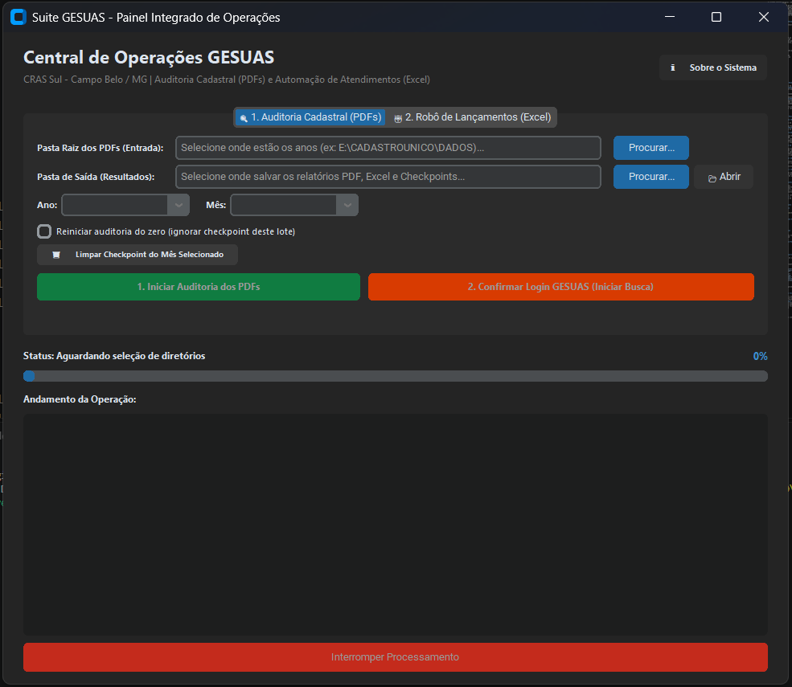
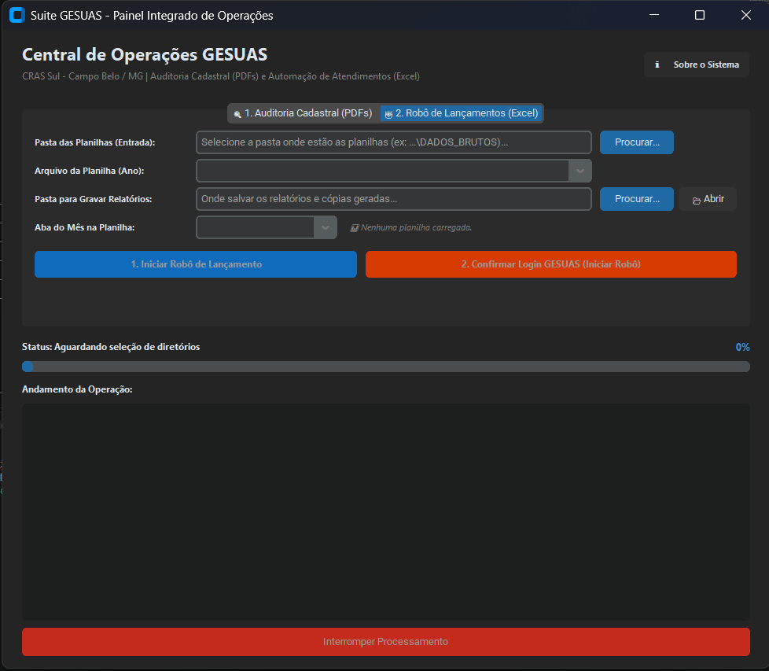

# 🏛️ Suite GESUAS - Central Integrada de Auditoria e Automação Cadastral

> **Vigilância Socioassistencial e Otimização Operacional do Cadastro Único**  
> **CRAS Sul — Prefeitura Municipal de Campo Belo / MG**

[](https://www.python.org/)
[](https://playwright.dev/)
[](https://github.com/TomSchimansky/CustomTkinter)
[](LICENSE)

---

## 📌 Visão Geral

A **Suite GESUAS** é uma solução computacional desktop construída para integrar automação robótica de processos (RPA), auditoria de prontuários eletrônicos e inteligência de dados aplicada à assistência social pública municipal. O software atua na convergência entre os formulários físicos/digitais arquivados e a base de dados do sistema **GESUAS** (plataforma de prontuário eletrônico do SUAS).

O ecossistema resolve gargalos crônicos do fluxo técnico do CRAS Sul:

* **Conferência em lote de conformidade cadastral:** Cruzamento automatizado de composições familiares entre os PDFs digitalizados e o banco do GESUAS antes de qualquer manipulação de dados.
* **Lançamento assistido de atualizações e atendimentos:** Leitura direta de planilhas de trabalho com validação de duplicidade histórica, eliminação de intervenções manuais repetitivas e saneamento cadastral de campos fundamentais.
* **Preservação de integridade e auditoria:** Emissão de relatórios analíticos em PDF e Excel, geração de cópias sincronizadas e proteção absoluta da planilha original de trabalho.

---

## 🔄 Fluxo de Trabalho Recomendado: A Primazia da Auditoria

Para assegurar a governança dos dados e a conformidade com as diretrizes do Ministério do Desenvolvimento e Assistência Social, Família e Combate à Fome (MDS), a operação da Suite GESUAS adota uma hierarquia estrita de execução:

```text
  ┌────────────────────────────────────────────────────────┐
  │ 1. AUDITORIA CADASTRAL PRELIMINAR (Módulo 1: PDFs)     │
  │    - Valida se o prontuário físico/PDF existe          │
  │    - Confere a composição familiar e RF no GESUAS      │
  │    - Aponta inconsistências sem alterar o banco        │
  └───────────────────────────┬────────────────────────────┘
                              │
                              ▼
  ┌────────────────────────────────────────────────────────┐
  │ 2. AUTOMAÇÃO DE LANÇAMENTOS (Módulo 2: Planilha Excel) │
  │    - Disparada após saneamento das divergências        │
  │    - Registra o atendimento com carimbo de tempo       │
  │    - Atualiza Código Familiar e fecha o atendimento    │
  └────────────────────────────────────────────────────────┘
```

> **⚠️ Diretriz Operacional:** A execução da **Auditoria Cadastral prévia é mandatória**. Disparar o robô de lançamentos sem a auditoria anterior pode acarretar inserções de atendimentos em prontuários desatualizados, desligados ou com inconsistência estrutural entre a família real e a declarada no sistema.

---

## 🔒 Escopo de Preenchimento e Delimitação Cadastral

Com foco na integridade das informações socioassistenciais e na conformidade com a LGPD, a versão atual do sistema adota um **escopo restrito de intervenção**. O robô **não** substitui a entrevista social nem altera variáveis complexas do formulário do Cadastro Único:

### ✅ O que a Suite GESUAS processa e atualiza

* **Data e Horário do Atendimento:** Preenchimento estrito com carimbo fidedigno extraído da planilha de trabalho.
* **Vínculo de Atendimento:** Registro normatizado como *"Sem vínculo de serviço"* e encerramento com *"Cadastramento/Atualização Cadastral na GESUAS"*.
* **Código Familiar:** Sanitização e sincronização do identificador numérico de 11 dígitos da família.
* **Forma de Acesso da Família:** Seleção compulsória da opção *"Por demanda espontânea"*.
* **Limpeza de Telefone Residencial:** Remoção de números legados corrompidos ou descontinuados para evitar contato equivocado.

### ⛔ Campos NÃO modificados pela automação (Intervenção Humana Exclusiva)

* **Condição de Deficiência (PcD):** Informações sobre existência de deficiência nos membros familiares, laudos ou necessidades especiais permanecem intocadas, exigindo comprovação documental e declaração assistida.
* **Endereço e Local de Residência:** Preservados intactos para não descaracterizar territórios de abrangência ou bairros.
* **Renda e Informações Financeiras:** Nenhum cálculo de renda per capita ou remuneração de membros é alterado.
* **Escolaridade e Ocupação:** Variáveis pedagógicas e de qualificação profissional mantêm-se exatamente como digitadas pelos operadores técnicos.
* **Contatos Pessoais / Celulares:** Informações detalhadas de contato e e-mail permanecem sob responsabilidade das entrevistas sociais presenciais.

---

## 🖥️ Interface do Usuário

A interface foi projetada com o framework **CustomTkinter** em modo escuro nativo (*Dark Mode*), oferecendo navegação intuitiva dividida entre os dois principais eixos operacionais:

| 🔍 Módulo 1: Auditoria Cadastral (PDFs vs GESUAS) | 🤖 Módulo 2: Robô de Lançamentos (Planilhas Excel) |
| :---: | :---: |
|  |  |
| *Varredura e validação cronológica de prontuários digitalizados com checkpoints de lote.* | *Processamento em lote de atendimentos com anti-duplicidade e saneamento cadastral.* |

---

## 📂 Estrutura do Repositório

O projeto adota uma arquitetura modular desacoplada:

```text
SUITE_GESUAS/
│
├── core/                           # Núcleo de processamento e motores do sistema
│   ├── Auditor/                    # Módulo 1: Auditoria Cadastral (PDFs vs GESUAS)
│   │   ├── __init__.py             # Inicializador do pacote
│   │   ├── auditor_engine.py       # Orquestrador da auditoria e despacho de eventos
│   │   ├── auditor_motor.py        # Motor lógico e regras de matching cadastral
│   │   ├── extrator_gesuas.py      # Inspeção de tela e busca no prontuário GESUAS
│   │   ├── gerador_relatorio_pdf.py# Compilador ReportLab (NumberedCanvas / Paisagem)
│   │   └── leitor_pdf.py           # Parser e extração textual de formulários PDF
│   │
│   ├── Automacao/                  # Módulo 2: Robô de Lançamentos (Planilhas Excel)
│   │   ├── __init__.py             # Inicializador do pacote
│   │   ├── automacao_engine.py     # Orquestrador da automação via Playwright CDP
│   │   ├── config.py               # Definições de portas, perfis e parâmetros locais
│   │   ├── gesuas_bot.py           # Procedimentos de manipulação do DOM e formulários
│   │   ├── notificacoes.py         # Tratamento de diálogos e alertas visuais
│   │   └── relatorio_pdf.py        # Relatório de atendimentos com legenda cromática
│   │
│   └── __init__.py                 # Pacote raiz do core
│
├── IMAGENS/                        # Capturas de tela da interface gráfica
│   ├── aba_auditoria.png           # Captura da interface do Módulo de Auditoria
│   └── aba_automacao.png           # Captura da interface do Robô de Lançamentos
│
├── .gitattributes                  # Controle de finais de linha (LF/CRLF) e binários
├── .gitignore                      # Filtro para LGPD, dados sensíveis e arquivos transitórios
├── app_suite.py                    # Interface gráfica unificada (CustomTkinter Multithread)
├── LICENSE                         # Licença MIT
├── README.md                       # Documentação técnica e operacional
├── requirements.txt                # Dependências externas do ecossistema Python
└── Suite_GESUAS.spec               # Especificação de compilação dual (Portátil e Diretório)
```

---

## 🗂️ Diretórios Gerados Dinamicamente em Tempo de Execução

As pastas de armazenamento de resultados **não integram o versionamento estático** do Git (sendo filtradas via `.gitignore` para resguardo de dados pessoais conforme a LGPD). Elas são criadas automaticamente pela aplicação dentro do diretório de destino apontado pelo operador:

| Diretório Gerado | Finalidade Operacional |
| :--- | :--- |
| `PLANILHAS_EXCEL/` | Armazena a cópia sincronizada da planilha com status `OK` preenchido (`CADASTRO_ATUALIZADO_[MÊS]_[TIMESTAMP].xlsx`) e o relatório analítico em formato de planilha. A planilha de entrada original nunca é sobrescrita. |
| `RELATORIOS_PDF/` | Recebe os relatórios oficiais formatados em PDF (paisagem), contendo métricas executivas consolidadas, totalizadores por tipo de serviço e estilização cromática. |
| `CHECKPOINTS/` | Registra arquivos temporários (`.json`) com o progresso do lote auditado. Permite pausar e retomar lotes volumosos de onde pararam ou reiniciar do início sob demanda. |

---

## ⚙️ Regras de Negócio e Funcionalidades Centrais

### 1. Conexão Acoplada via CDP (Chrome DevTools Protocol)

* **Login pelo Operador:** O sistema inicializa uma sessão do Microsoft Edge conectada via porta `9222` (`--remote-debugging-port=9222`), permitindo que o operador realize seu login convencional no GESUAS manualmente antes de liberar a execução do robô.
* **Resiliência e Desacoplamento:** Elimina a necessidade de embutir credenciais ou senhas em arquivos de configuração e dispensa a criação de perfis descartáveis a cada bateria de testes.
* **Prontidão de Segurança:** A arquitetura desacoplada via CDP já está estruturalmente preparada para ambientes que exijam futuramente autenticação em dois fatores (MFA) ou certificados digitais Gov.br, sem requerer mudanças na lógica do motor Playwright.

### 2. Validação Anti-Duplicidade via DOM Assíncrono

* Avalia diretamente o conteúdo renderizado na modal `Editar um Atendimento` via scripts JavaScript injetados no DOM.
* Se a data e o horário já constarem lançados no histórico familiar do GESUAS, o registro é confirmado com `OK`, a janela é fechada no botão de saída e a rotina avança para o próximo munícipe sem gerar duplicidades.

### 3. Tratamento Dinâmico de Membros Não-RF

* Caso a pessoa atendida na planilha não seja o Responsável Familiar (RF):
  1. Identifica a pessoa de referência exibida em tela;
  2. Preserva a seleção do operador técnico municipal;
  3. Desmarca os membros familiares anteriores via script DOM;
  4. Marca exclusivamente a pessoa atendida na lista de *Pessoas atendidas*.

### 4. Saneamento Cadastral em 'Editar Família'

* **Código Familiar:** Sanitiza pontuações e hifens, gravando apenas caracteres numéricos.
* **Telefone Residencial:** Limpa números legados desatualizados com seleção total e remoção.
* **Forma de Acesso:** Vincula compulsoriamente a opção `"Por demanda espontânea"`.

### 5. Tratamento de Tipos e Nulos (Blindagem contra `NaT`)

* Parsing seguro de células de data e hora do Excel via `pd.isna()`.
* Evita falhas críticas de execução do tipo `NaTType does not support strftime` em linhas vazias ou no encerramento da planilha.

---

## 🗺️ Roadmap de Atualizações Futuras

O projeto encontra-se em desenvolvimento contínuo, prevendo as seguintes expansões para versões subsequentes:

* [ ] **Módulo de Atualização Sociodemográfica Plena:** Rotina assistida para preenchimento de endereço, telefone atualizado e contatos de referência a partir de planilhas higienizadas.
* [ ] **Identificação e Validação de PcD / BPC:** Cruzamento automático do campo de deficiência com os cadastros ativos de BPC Deficiente.
* [ ] **Auditoria de Renda e Divergências Financeiras:** Comparador entre renda declarada no CadÚnico vs. lançamentos de benefícios sociais no prontuário.
* [ ] **Dashboard Integrado de Vigilância Socioassistencial:** Painel analítico de famílias unipessoais com/sem visita domiciliar, cobertura de BPC (Idoso/PcD) e averiguações do Programa Bolsa Família (PBF).
* [ ] **Disparo Automatizado de Alertas de Desligamento:** Identificação proativa de munícipes com pendência de retorno para manutenção do cadastro ativo.

---

## 🛠️ Tecnologias e Bibliotecas

* **Python 3.10+** (64 bits)
* **CustomTkinter:** Framework moderno de componentes GUI com suporte a temas e redimensionamento responsivo.
* **Playwright:** Controle e inspeção do navegador via protocolo CDP.
* **Pandas & OpenPyXL:** Leitura, manipulação de matrizes de dados e exportação de planilhas Excel.
* **ReportLab:** Mecanismo vetorial de compilação de PDFs com numeração de páginas em duas passagens (`NumberedCanvas`).
* **PDFPlumber:** Extração de texto e metadados a partir dos comprovantes digitais.

---

## 🚀 Como Executar o Projeto

### 1. Clonar o Repositório

```powershell
git clone https://github.com/SEU_USUARIO/SUITE_GESUAS.git
cd SUITE_GESUAS
```

### 2. Configurar o Ambiente Virtual

```powershell
python -m venv .venv
.\.venv\Scripts\activate
```

### 3. Instalar Dependências

```powershell
pip install -r requirements.txt
playwright install chromium
```

### 4. Inicializar a Aplicação

```powershell
python app_suite.py
```

---

## 📦 Estratégia de Distribuição e Empacotamento Dual

Para atender à diversidade do parque tecnológico dos órgãos públicos, a Suite GESUAS conta com uma especificação do PyInstaller (`Suite_GESUAS.spec`) que gera duas modalidades de saída simultaneamente:

1. **`dist/Suite_GESUAS_Portatil.exe` (`--onefile`):**
   * **Perfil:** Arquivo único portátil.
   * **Recomendação:** Computadores modernos com armazenamento SSD/NVMe ou para transporte rápido em pendrives.
   * **Comportamento:** Descompacta temporariamente as dependências na inicialização em `%TEMP%`.
2. **`dist/Suite_GESUAS_Diretorio/` (`--onedir`):**
   * **Perfil:** Pasta independente de execução direta com atalho para `Suite_GESUAS.exe`.
   * **Recomendação:** Computadores com disco rígido mecânico (HDD convencional) e máquinas de desempenho modesto.
   * **Comportamento:** Abertura imediata em 1 a 2 segundos, eliminando a sobrecarga de descompactação e a retenção por varredura contínua de antivírus.

### Como gerar ambas as versões

Com o ambiente virtual ativado no terminal:

```powershell
pyinstaller Suite_GESUAS.spec
```

Os resultados estarão prontos para uso no diretório `dist/`.

---

## 👨‍💼 Autoria e Lotação Institucional

* **Autor:** Juliano França da Mata  
* **Cargo:** Agente Administrativo / Operador do Cadastro Único  
* **Lotação:** CRAS Sul — Prefeitura Municipal de Campo Belo / MG  
* **Contato:** `jfmatta@gmail.com`  
* **Qualificação Técnica e Acadêmica:**  
  * Bacharel em Ciência de Dados e Inteligência Artificial (UniDomBosco)  
  * Tecnólogo em Gestão de Tecnologia da Informação (UniCesumar)  
  * Técnico em Informática  

---

## 📜 Licença

Este projeto é distribuído sob os termos da licença [MIT](LICENSE).
